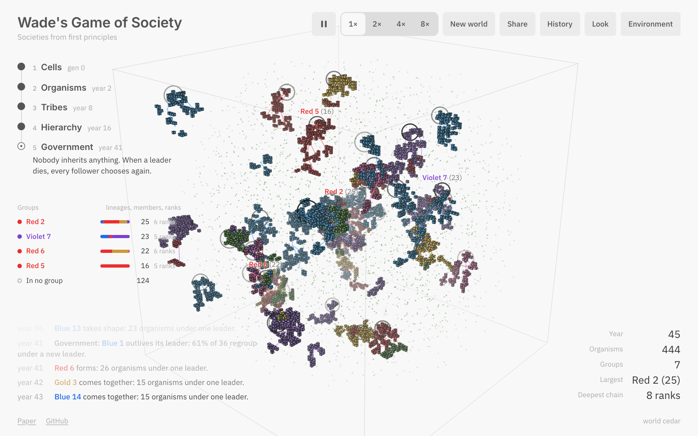

# Syntropy



### [**Watch it run →**](https://syntropy-sim.vercel.app) &nbsp; [**Read the paper →**](https://syntropy-sim.vercel.app/paper/) &nbsp; [PDF](https://syntropy-sim.vercel.app/paper/syntropy.pdf)

Syntropy is a 3D take on Conway's Game of Life that keeps climbing. Coloured cells on a lattice settle into forms. Each form that holds its shape for twenty generations comes loose as an organism made of exactly those cells, in exactly that place, while the rest of the lattice keeps running until it settles and its last cells dissolve. Organisms eat, grow a cell when they have surplus, burn one when they starve, split in two, fight and age. Then they start following each other, and the world climbs through tribes and hierarchies to realms that regroup under a new ruler when the old one dies.

None of that is scripted. There's no rule for tribes, ranks, conquest, rebellion, heirs or government. Every organism makes one choice, over and over: follow whoever keeps it safest, net of the tribute it would pay, or follow no one. Conquest, secession and succession all fall out of that one choice, and the ladder on the left of the screen only reports what a measurement noticed.

It runs in your browser with no server behind it, and each world has a seed in the URL, so a link replays the same history.

## The ladder

| Level | What happens | Reached when |
| --- | --- | --- |
| 1. Cells | 3D Life on a 48³ lattice: a dead cell with 7 or 8 live neighbours is born, a live cell with 1 to 5 survives. Newborns take the most common lineage around them. | The lattice starts alive |
| 2. Organisms | A form that keeps its place and size for 20 generations comes loose as one body made of its cells. Intake and upkeep scale with mass^0.75 (Kleiber's law). Surplus builds a cell, deficit burns one, and a body of 12 cells splits in two. | The first form comes loose |
| 3. Tribes | Organisms choose whom to follow by local safety, net of tribute. Kin threaten each other less and tax each other less. | 3 groups of 10+, mostly kin, follow one chief |
| 4. Hierarchy | Fights are Tullock contests between the local mass of two polities, and the loser loses cells to the winner. Tribute flows up every chain. | A realm of 30+ rules other lineages through 4 ranks |
| 5. Government | When a ruler dies nobody inherits, and every orphan chooses again. | 60% of a realm of 30+ regroup under one new ruler within 240 ticks |

Levels can only be reached in order.

## Reading the picture

- Every organism is drawn as its own cells, in the colour of the lineage it came from (Blue, Red, Gold, Green, Violet or Rose).
- A line runs from every follower up to its lord, in the colour of the ruler's lineage, so a Blue line on a Red body means Blue rules it.
- Each rank is drawn one step below its lord, so a realm hangs from its ruler like an upside-down tree. The step exists only in the drawing, and the simulation never sees it.
- A ring marks a ruler, and it darkens as the realm grows.
- The faint stipple is food. It thins where a realm grazes and grows back after.
- Hovering an organism traces its chain of command and shows its rank, size and age.
- The Look menu switches between Paper (the default), Night, Blueprint, Ink and Nebula. The Environment panel changes food, fighting, tribute, kinship, control loss, lifespan and choice noise live, and the URL carries your settings.

## Looking inside

Everything here reads the simulation and changes nothing in it, except the one button that removes a ruler.

- **Captions and a guided camera.** A narrator says what just happened and why no rule asked for it, and the camera moves in on it. The Look menu switches off the captions, the guided camera and the slow rotation (`R`).
- **Realms.** The list under the ladder shows each realm with its members, its ranks and the lineages inside it. Pointing at a row lights that realm and pales the rest, and a click follows its ruler.
- **One organism's choice.** Clicking an organism opens a card with every option it can see and the score of each: its odds of winning nearby, times the share it keeps after tribute, times the control left through the ranks above it. A lens on the world draws how far it sees and a line to each lord it could follow. The card also lists the chain of command above it and its direct followers, and each of those can be picked.
- **Remove a ruler.** A ruler's card has a button that removes it. Time slows, its former members light up, and a meter shows how much of the realm has regrouped under one new ruler against the 60% line. The strike goes into the link as `?k=`, so a shared link replays the same history.
- **History.** The History button draws the world as it happens. Each realm that grew to 15 or more is a band as tall as its members, with a mark for every ruler's death. A click pins a year and replays the world from its seed up to that year, and the chart saves as an image.
- **The paper beside the world.** In the side pane the paper has buttons that run its claims in the world on the left: set fear to 0, start again with no fights, remove the largest realm's ruler. Two of its figures draw the running world over the 48-world result.

## The paper

[Syntropy: From Cells to Government](https://syntropy-sim.vercel.app/paper/) is the full write-up: the model, the derivation of the allegiance rule (the Kelly criterion applied to Hobbes' bargain), the measurements, and the experiments. Those are a 48-world baseline, ablations of every ingredient, a phase diagram over fear and tribute, an analysis of what makes a realm survive its ruler, and the search behind the lattice rule. Every number in it is filled in from the experiment output when the paper is built.

## Tuning and experiments without graphics

The simulation core in `src/sim` is plain TypeScript with no browser dependencies, so Node runs it directly (Node 22.18+ strips the types).

```bash
npm run world -- --seed cedar --ticks 9000
```

That prints one world's history as a chronicle, at 100 ticks to a year:

```
y  3 *** Organisms: a Gold form holds together and comes loose from the lattice.
y  9 *** Tribes: 3 kin groups now follow chiefs.
y 17 *** Hierarchy: Kais rules 4 tribes through 6 ranks.
y 42 *** Government: Kais outlives its ruler: 61% of 36 regroup under a new ruler.
```

```bash
npm run sweep -- --sets 200 --refine 90 --seeds 6 --ticks 9000
```

The sweep searches 26 parameters on worker threads, refines around the best sets and confirms the winner on 16 seeds it never trained on. It scores worlds on whether every level appears in order at a pace you can watch, whether several realms coexist, and whether chains of command stay readable. The current defaults came out of it.

```bash
npm run experiments
npm run figures
npm run paper
```

These regenerate the paper's data (about five minutes on 16 threads), draw its figures and rebuild it. `npm run paper:pdf` prints the PDF while the dev server is running.

## How consistent it is

All 48 seeded worlds in the paper's baseline climbed the whole ladder within 150 simulated years. The median world formed tribes in year 9.4, a hierarchy in year 22.8 and a government in year 37.8, which at the default speed comes about a minute after the first organism. The ablations switch off one ingredient at a time on 32 worlds each. Without fear of unallied neighbours nothing forms at all, while worlds with no fights, no tribute or no kin preference still reached government every time. The phase diagram in the paper maps where in fear and tribute each level stops appearing.

## Running it

```bash
npm install
npm run dev
```

`npm run build` writes a static site to `dist/`, with the simulation and the paper. It's Vite and Three.js with no server code, so a visit costs a few hundred kilobytes of static transfer and nothing else. On screens 1180px and wider the paper opens beside the world, and the divider drags to resize it or folds either side away. Space pauses, `N` makes a new world, `H` hides the interface, `P` folds the paper, `R` stops or starts the rotation, and `1` to `4` set the speed.

## Layout

- `src/sim/cells.ts` is the lattice and form tracking.
- `src/sim/society.ts` holds the organisms, the allegiance rule, polities, events and ladder checks.
- `src/sim/world.ts` joins the two levels into one continuous world.
- `src/sim/score.ts` turns a run into numbers and a score.
- `src/render/` draws cubes, rings, lines and food, and holds the themes.
- `src/ui/` is the ladder, chronicle, readouts and panels, plus the guide: `story.ts` (captions and the succession watch), `director.ts` (camera), `card.ts` (one organism's choice), `realms.ts`, `timeline.ts` (history) and `bridge.ts` (the paper's experiments).
- `scripts/` holds the headless runner, sweep, experiments, figures and the paper build.
- `paper/` is the paper source, data and figures.

The default look follows `docs/taste/ciechanow.ski.md`: one paper ground, gray controls, a single ink outline, and colour spent only on the organisms and the words that name them.

MIT licensed.
